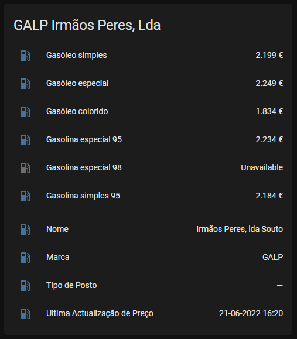
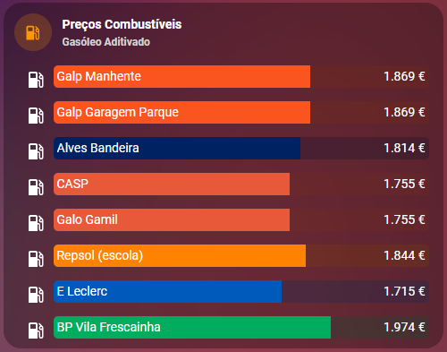

[](https://www.home-assistant.io/integrations/marketplace/)


# Preços dos Combustíveis - DGEG
Fuel Prices in Portugal - Custom Component for Home Assistant

The data source for this integration is the [DGEG - Direcção-Geral de Energia e Geologia](https://www.dgeg.gov.pt/).

The author of this project categorically rejects any and all responsibility for the fuels prices that were presented by the integration.

# Installation
## Marketplace (Recommended)
This integration can be installed from the Home Assistant [Marketplace](https://www.home-assistant.io/integrations/marketplace/), which comes with Home Assistant and replaces HACS. If you were using HACS, the Marketplace migrates your installation automatically and it keeps receiving updates.

1. Navigate to `Settings > Marketplace` (administrators only). The first time, accept the warning about community content.
2. Search for `DGEG - Preços dos Combustíveis`
3. Open the repository page and click `Install`, then confirm the version
4. When the installation finishes, the integration setup opens (if Home Assistant asks for a restart, restart it). Now continue with the configuration.

If you can't find it in the catalog, you can add it as a custom repository (this requires [connecting GitHub](https://www.home-assistant.io/integrations/marketplace/#connecting-github)):

1. In `Settings > Marketplace`, click `Add from link`
2. Enter `netsoft-ruidias/ha-custom-component-precoscombustiveis` and click `Add`
3. Open the repository page and click `Install`

To update, go to `Settings > Updates`. After updating, restart Home Assistant to apply the update.

## Manual
Manual installation is not recomended

# Configuration

## Through the interface
1. Navigate to `Settings > Devices & Services` and then click `Add Integration`
2. Search for `Precos Combustiveis`
3. Choose what you want to add: a `Posto de Combustível` (gas station) or the `Previsão da evolução semanal de preços` (weekly price variation forecast)

### Gas station
1. (Go to [dgeg](https://precoscombustiveis.dgeg.gov.pt/api/PrecoComb/ListarDadosPostos), search for the desired gas station and copy it's `Id`)
2. Enter the StationId you copied in the previous step
3. Repeat the procedure as many times as desired to include other stations

### Weekly price variation forecast
Select `Previsão da evolução semanal de preços` and choose which fuels you want (`Gasolina 95` and/or `Gasóleo`). One sensor is created per selected fuel.

To add or remove fuels later, open the `Previsão semanal` integration entry and click `Configure` (the currently active fuels come pre-selected). Unchecking a fuel deletes its sensor.

The data source for the forecast is [precocombustiveis.pt](https://precocombustiveis.pt/proxima-semana/), which is updated weekly.

Each sensor, e.g. `Previsão semanal Gasóleo`, has:

| | |
|---|---|
| **State** | Forecast price variation for next week, in `€/L`. Positive = rise, negative = fall (e.g. `-0.045` = falls 4.5 cents per liter). Being numeric, its history is kept by Home Assistant. |
| **Icon** | `mdi:trending-up`, `mdi:trending-down` or `mdi:trending-neutral`, according to the trend |

| Attribute | Description |
|---|---|
| `ForecastStart` | First day (Monday) of the forecast week, `YYYY-MM-DD` |
| `ForecastEnd` | Last day (Sunday) of the forecast week, `YYYY-MM-DD` |
| `LastUpdate` | Date of the last update of the source page, `YYYY-MM-DD` |
| `Trend` | `sobe` (rise), `desce` (fall) or `neutro` |
| `VariationLevel` | `nula` (no change), `ligeira` (below 2 cents), `moderada` (2 up to 6 cents) or `forte` (6 cents or more) |
| `FormattedVariation` | Variation ready to display, e.g. `+ 6 cent€/Lt`, `- 4,5 cent€/Lt` |

```yaml
type: entities
entities:
  - entity: sensor.previsao_semanal_gasoleo
    name: Gasóleo
  - type: attribute
    entity: sensor.previsao_semanal_gasoleo
    attribute: FormattedVariation
    name: Variação prevista
```

## Through configuration.yaml
Manual configuration through _configuration.yaml_ is not recomended, please use the interface configuration as described above

## Sample
One can use the standard [entities](https://www.home-assistant.io/dashboards/entities/) card to display data in the UI:

```yaml
type: entities
entities:
  - entity: sensor.galp_irmaos_peres_lda_souto_gasoleo_simples_2
    name: Gasóleo simples
  - entity: sensor.galp_irmaos_peres_lda_souto_gasoleo_especial
    name: Gasóleo especial
  - entity: sensor.galp_irmaos_peres_lda_souto_gasoleo_colorido
    name: Gasóleo colorido
  - entity: sensor.galp_irmaos_peres_lda_souto_gasolina_especial_95
    name: Gasolina especial 95
  - entity: sensor.galp_irmaos_peres_lda_souto_gasoleo_simples
    name: Gasolina especial 98
  - entity: sensor.galp_irmaos_peres_lda_souto_gasolina_simples_95
    name: Gasolina simples 95
  - type: divider
  - entity: sensor.galp_irmaos_peres_lda_souto_gasolina_simples_95
    type: attribute
    attribute: Name
    name: Empresa
    icon: mdi:greenhouse
  - entity: sensor.galp_irmaos_peres_lda_souto_gasolina_simples_95
    type: attribute
    attribute: Brand
    name: Marca
    icon: mdi:widgets
  - entity: sensor.galp_irmaos_peres_lda_souto_gasolina_simples_95
    type: attribute
    attribute: StationType
    name: Tipo de Posto
  - entity: sensor.galp_irmaos_peres_lda_souto_gasolina_simples_95
    type: attribute
    attribute: LastPriceUpdate
    name: Ultima Actualização de Preço
    icon: mdi:reload
title: GALP Irmãos Peres, Lda
```
Which will result in the following card:



Or, if you prefer, you can even use a [custom:auto-entities](https://github.com/thomasloven/lovelace-auto-entities) card to auto display your prices:

```yaml
type: custom:auto-entities
card:
  type: entities
  title: Diesel Prices
filter:
  include:
    - entity_id: /sensor\..*_gasoleo/
sort:
  method: state
  numeric: true
  reverse: false
```

Or, use the [custom:bar-card](https://github.com/custom-cards/bar-card) integration to display a nice graph:

```yaml
type: custom:stack-in-card
cards:
  - type: custom:mushroom-template-card
    primary: Preços Combustíveis
    secondary: Gasóleo Aditivado
    icon: mdi:gas-station
    icon_color: orange
  - type: custom:bar-card
    entities:
      - entity: sensor.galp_garagem_parque_de_barcelos_lda_gasoleo_especial
        name: Galp Manhente
        color: '#FA551E'
      - entity: sensor.galp_garagem_parque_de_barcelos_lda_gasoleo_especial_2
        name: Galp Garagem Parque
        color: '#FA551E'
      - entity: sensor.alves_bandeira_ab_de_tamel_gasoleo_especial
        name: Alves Bandeira
        color: '#002262'
      - entity: >-
          sensor.freitas_casp_area_de_servico_portas_do_cavado_lda_gasoleo_especial
        name: CASP
        color: '#E75938'
      - entity: sensor.generico_aparicio_carvalho_araujo_lda_gasoleo_especial
        name: Galo Gamil
        color: '#E75938'
      - entity: sensor.repsol_e_s_barcelos_ii_gasoleo_especial
        name: Repsol (escola)
        color: '#FF8200'
      - entity: sensor.leclerc_e_leclerc_barcelos_gasoleo_especial
        name: E Leclerc
        color: '#005ABB'
      - entity: sensor.bp_bp_barcelos_frescainha_gasoleo_especial
        name: BP Vila Frescainha
        color: '#00AD5E'
    height: 25px
    decimal: 3
    min: 0.5
    max: 2.5
    positions:
      name: inside
      value: inside
      icon: outside
      indicator: 'off'
      minmax: 'off'
    style: |
      bar-card-name{
        margin-right: 10px !important;
        font-size: var(--paper-font-body1_-_font-size);
        white-space: nowrap;
      }
      bar-card-background{
        margin: 4px 0 4px 0 !important;
      }
      ha-card{
        --bar-card-border-radius: 5px;
      }
      #states{
        padding: 0 16px;
      }
      #states > * {
          margin-bottom: 0px;
      }
```

Which will result in the following card:



## Map Card

Since version v1.4.0 you can also add these entities to your map card, to show them in your map

```yaml
type: map
entities:
  - entity: zone.home
  - entity: zone.other
  - entity: person.one
  - entity: person.two
  - entity: person.three
  - entity: sensor.galp_garagem_parque_de_barcelos_lda_gasoleo_especial
    name: GALP
  - entity: sensor.bp_bp_barcelos_frescainha_gasoleo_especial
    name: BP
hours_to_show: 12
default_zoom: 12
dark_mode: true
```

# Legal notice
This is a personal project and isn't in any way affiliated with, sponsored or endorsed by [DGEG](https://www.dgeg.gov.pt/).

All product names, trademarks and registered trademarks in (the images in) this repository, are property of their respective owners. All images in this repository are used by the project for identification purposes only.
